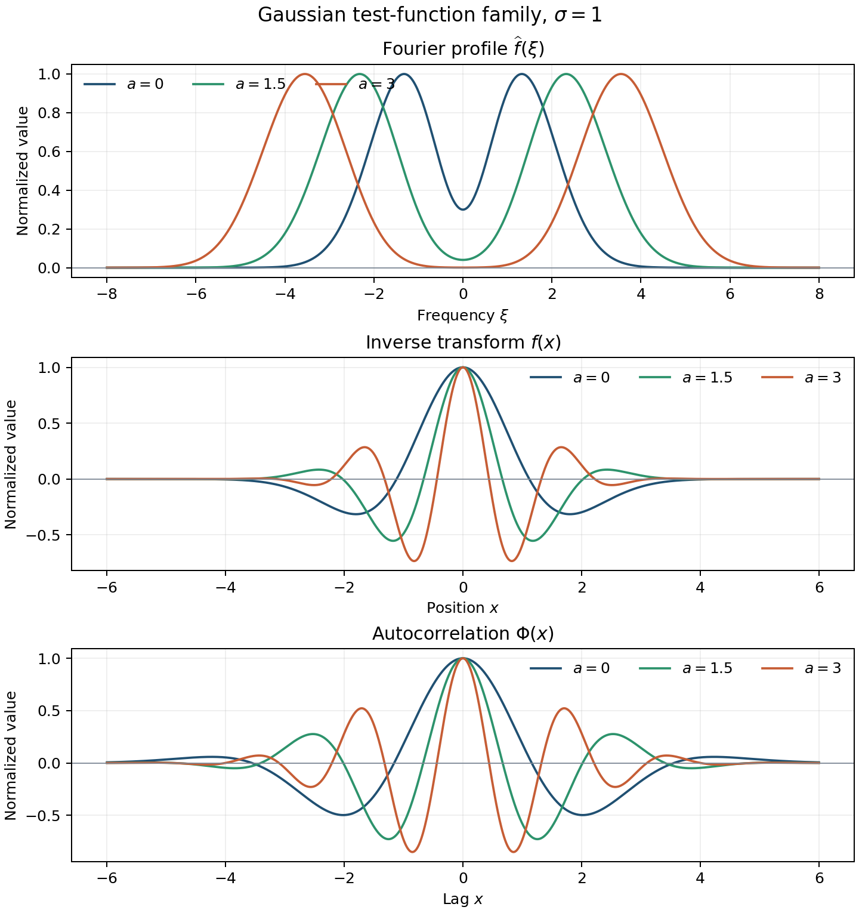

# Weil Gaussian Lab

Weil Gaussian Lab is an MIT-licensed Python library for reproducible experiments
with polynomial-Gaussian test functions. It combines analytic Fourier and
autocorrelation formulas, multi-zero construction, Gram-matrix diagnostics,
finite prime-power sums, and an independent high-precision CLI verifier. The
[technical note (PDF)](paper/gaussian_identities.pdf) gives the definitions and
derivations; [LaTeX source](paper/gaussian_identities.tex) is included.

**Scope:** the \(L^2\) Gram matrix is positive semidefinite by construction.
Finite Weil-form and prime-balance calculations are numerical diagnostics,
without a certified infinite prime tail. Neither they nor the test suite
establish the Riemann Hypothesis. See [research scope](docs/RESEARCH_SCOPE.md)
for the claim boundaries and the correction to an older draft.

## Mathematical model

The Fourier convention is

$$
\widehat f(\xi)=\int_{\mathbb R}f(x)e^{-i\xi x}\,dx,\qquad
f(x)=\frac{1}{2\pi}\int_{\mathbb R}\widehat f(\xi)e^{i\xi x}\,d\xi.
$$

For center \(a\geq0\), width \(\sigma>0\), and specified complex zeros \(Z\),
the spectrum is a real-even polynomial in \(\xi\) times a pair of shifted
Gaussians:

$$
F_{a,\sigma,Z}(\xi)=P_Z(\xi^2)
\left(e^{-(\xi-a)^2/(2\sigma^2)}
     +e^{-(\xi+a)^2/(2\sigma^2)}\right).
$$

Each requested zero enforces its negative; non-axis complex zeros also enforce
their conjugates. This keeps the spectrum real and even on the real line.
With \(Z=\{i/2\}\), \(P_Z(\xi^2)=\xi^2+1/4\), matching the original family.
Repeated requested zeros increase multiplicity. The package evaluates the
inverse transform and autocorrelation analytically for these families.
The family reports whether it has the \(i/2\) zero required by the
Weil-named diagnostics; a custom zero set without it remains useful for
Gaussian calculations but is rejected by those diagnostics.

The figure normalizes each curve separately to compare shape, not amplitude.
Recreate it with the optional plotting extra:

~~~bash
python -m pip install -e '.[plot]'
python examples/plot_profiles.py
~~~

## Install and quickstart

Python 3.10 or newer is required.

~~~bash
python -m pip install -e '.[test]'
weil-gaussian verify --center 1.2 --width 0.9 --position 0.8 --dps 40
python -m weil_gaussian prime-sum --center 1.2 --width 0.9 --limit 100
weil-gaussian benchmark --points 100 --repeats 2
~~~

A verifier run prints analytic values beside independently integrated Fourier
values, absolute errors, and a final status. A sample run is:

~~~text
quantity          position       analytic     quadrature       abs error  status
inverse               0.8     -0.0449014     -0.0449014      1.004e-16  PASS
autocorrelation       0.8      -0.060856      -0.060856      6.272e-17  PASS
PASS: 2 comparisons at 40 digits; numerical check only, not an RH test.
~~~

The last error digits depend on the numeric platform. Repeat the --zero
option to verify a custom multi-zero family, for example
--zero 0.5j --zero 1+0.5j. The finite prime-power demonstration reports both
the archimedean component and a cutoff-dependent balance. Abbreviated output:

~~~text
Finite prime-power diagnostic: center=1.2, width=0.9, cutoff=100
Prime-power terms through cutoff: 35
2 * sum Lambda(n) Phi(log n) / sqrt(n) = -3.09114500231
Archimedean K = -4.51535568786
Finite P_N = -3.09114500231
Cutoff-dependent K - P_N = -1.42421068555
Quadrature error estimate = 1.68e-12; converged=True
... individual prime-power terms ...
No prime-tail bound; not the full Weil form or an RH test.
~~~

The benchmark reports median and range of wall-clock timings plus Python and
NumPy versions; timings vary by machine and are not cross-machine performance
claims. All three commands support help and JSON output for reproducible
scripts.

The Python API also accepts NumPy-compatible arrays:

~~~python
import numpy as np
from weil_gaussian import PolynomialGaussianFamily

family = PolynomialGaussianFamily(
    center=2.0, width=0.8, zeros=(0.5j, 1.0 + 0.5j)
)
frequency = np.linspace(-8, 8, 201)
position = np.linspace(-5, 5, 201)
spectrum = family.fourier(frequency)
signal = family.inverse(position)
overlap = family.autocorrelation(position)
~~~

## Architecture

| Component | Purpose | Interpretation |
| --- | --- | --- |
| [Core formulas](src/weil_gaussian/core.py) | Original two-parameter spectrum, inverse, autocorrelation, and exact mass | Analytic identities |
| [Multi-zero families](src/weil_gaussian/families.py) | Real-even polynomial construction and analytic transforms | Zeros of the chosen test function |
| [Gram diagnostics](src/weil_gaussian/gram.py) | Pairings, eigenvalues, and conditioning across parameter grids | \(L^2\) positivity is unconditional; finite Weil results are exploratory |
| [Arithmetic](src/weil_gaussian/arithmetic.py) | Enumerated prime-power terms through a cutoff | Finite sum, no tail estimate |
| [Balance diagnostics](src/weil_gaussian/balance.py) | Archimedean integral versus finite prime-power term | Numerical balance, not the full Weil value |
| [CLI](src/weil_gaussian/cli.py) | High-precision verification, prime balance, and environment-tagged benchmark output | Reproducible command output |
| [Tests](tests) and [CI](.github/workflows/ci.yml) | Independent quadrature, invariants, edge cases, and paper build | Regression evidence, not proof of all claims |

The \(L^2\) Gram entries use
\(G_{ij}=(2\pi)^{-1}\int_{\mathbb R}F_i(\xi)F_j(\xi)\,d\xi\).
Its eigenvalues and condition number describe linear dependence of the chosen
test functions. The finite Weil matrix and balance output depend on a
specified prime cutoff; their eigenvalues cannot certify spectral positivity
for the infinite problem.

## Reproduce and contribute

~~~bash
python -m pytest -q
python examples/compare_with_quadrature.py
cd paper && latexmk -pdf -interaction=nonstopmode -halt-on-error gaussian_identities.tex
~~~

Tests compare closed forms with independent high-precision defining integrals
and exercise symmetry, normalization, parameter limits, invalid inputs, CLI
behavior, and matrix diagnostics. The library's regular arrays use
double-precision NumPy values; extreme parameters can lose relative precision
or overflow. Report sensitive cases with a high-precision reference and an
error estimate.

See [CONTRIBUTING.md](CONTRIBUTING.md) for mathematical and code review
requirements, [SECURITY.md](SECURITY.md) for private vulnerability reporting,
[LICENSE](LICENSE) for reuse, and [CITATION.cff](CITATION.cff) for citation.
